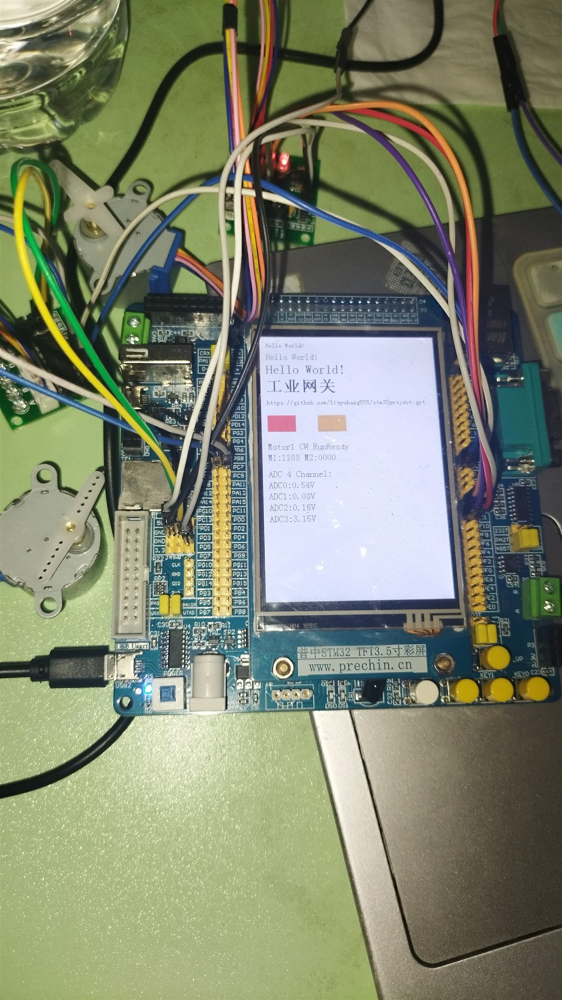
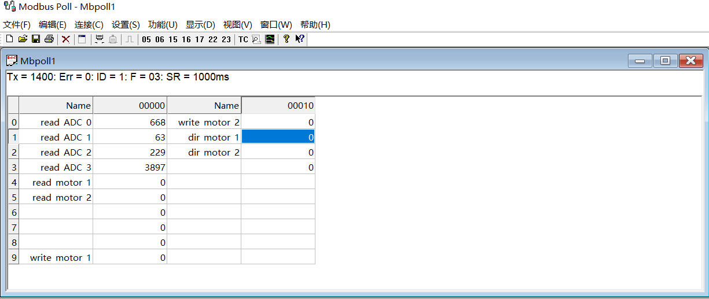
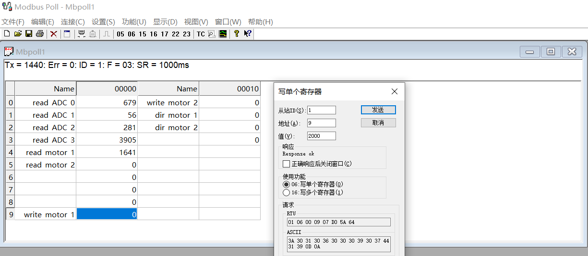

# 工业边缘网关监控节点（STM32F407 + FreeRTOS + FreeModbus + LVGL）

基于 STM32F407ZGT6 的工业监控节点：双路步进电机控制、4 路模拟量采集与过流/过压保护、Modbus RTU 从站通信、3.5 寸触摸屏上的 LVGL 监控界面。

## 硬件

| 项 | 说明 |
|---|---|
| MCU | STM32F407ZGT6，168MHz，1MB Flash / 192KB RAM |
| 显示屏 | 3.5 寸 320\*480 TFT（HX8357D 控制器），FSMC 8 位 8080 并口 |
| 通信 | RS485（USART2，PG8 控制收发方向），Modbus RTU 从站，9600-8N1，站号 1 |
| 电机 | 两路步进电机驱动（TIM6 更新中断统一产生步进节拍） |
| 采集 | ADC1 通道 PA4~PA7：母线电压 / M1 电流 / M2 电流 / 预留通道 |
| 存储 | 24C02（I2C）保存保护阈值 |
| 人机 | 4 个按键（KEY0/KEY1/KEY2/KEY_UP）+ 蜂鸣器 |

## 软件架构

```
应用层   Task_MainApp    按键、阈值调节、Modbus 指令分发、显示数据打包
        Task_Protect    急停 + 蜂鸣 + 界面报警 + 故障记录
通信层   Task_Modbus     FreeModbus RTU 从站轮询
控制层   Task_Motor      消费电机指令队列
采集层   Task_ADC        ADC 采集 + 一阶滤波 + 阈值判断
存储层   Task_Param      阈值读写与掉电保存
界面层   Task_GUI        LVGL 刷新 + 消费显示队列
监控层   Task_WDT        任务心跳 + IWDG 喂狗
```

共 9 个 FreeRTOS 任务，用队列（电机指令 / ADC 数据 / 显示帧）、互斥锁（电机资源 / 参数）、二值信号量（保护触发）、计数信号量（心跳）解耦。

优先级分配：保护 30 > 电机 25 > ADC 20 > 参数 10 > WDT 8 > GUI 5 > Modbus 4 > MainApp 3 > LED 2。

## 主要功能

- **双步进电机控制**：TIM6 1kHz 基准，动态改写 ARR 调速（10~2000），支持方向/步数寄存器与紧急停止
- **模拟量保护**：母线过压 / 双电机过流触发最高优先级保护任务，急停、蜂鸣 1 秒、界面红字报警并记录故障
- **Modbus RTU 从站**：ADC 原始值、剩余步数、保护阈值（可读可写）、目标步数、方向、速度
- **参数掉电保存**：阈值改动自动写 24C02，magic 校验失败回落默认值
- **三页监控界面**：电机状态与 ADC 采集（含 60 秒电流趋势图）/ 故障记录 / 参数设置，KEY0 切页
- **双层看门狗**：7 个任务的软件心跳（2 秒超时）+ IWDG 硬件复位

## Modbus 保持寄存器（Poll 起始地址 1）

| Poll 地址 | 读写 | 含义 |
|---|---|---|
| 1~4 | 读 | ADC CH0~CH3 原始值 |
| 5 / 6 | 读 | M1 / M2 剩余步数 |
| 7 / 8 | 读/写 | 电流阈值 / 电压阈值（1~4095） |
| 10 / 11 | 写 | M1 / M2 目标步数 |
| 12 / 13 | 读/写 | M1 / M2 方向 |
| 14 | 读/写 | 全局速度（TIM6 ARR，10~2000） |

## 按键

| 键 | 功能 |
|---|---|
| KEY0 | 切换界面页面 |
| KEY2 | 选择要调节的阈值（电流 / 电压） |
| KEY1 | 阈值 -50 |
| KEY_UP | 阈值 +50 |

## 运行与验证

硬件实物（F407ZGT6 开发板 + 3.5 寸彩屏；屏上画面为早期裸写刷屏版本的调试截图，当前固件为 LVGL 三页界面）：



Modbus Poll 读取保持寄存器（ADC 原始值、电机剩余步数、保护阈值、速度）：



Modbus Poll 写单寄存器（下发目标步数）：



## 目录结构

```
User/         main.c（外设初始化、任务创建、Task_MainApp / Task_Modbus）
System/       SysTick / delay
Start/        启动文件、system_stm32f4xx
Library/      STM32F4 标准外设库
Driver/       src + inc：tftlcd、i2c、step_motor、adc、beep、key、wdt、24cxx、task_*
GUI/          lv_conf.h、lvgl（LVGL 8.3.11 源码）、lvgl_driver（显示移植层）、
              app（lv_app 界面 + 中文子集字体）、LVGL移植说明.md
FreeModbus/   FreeModbus 从站协议栈 + BARE 平台移植
FreeRTOS/     FreeRTOS 内核与移植层
image/        调试截图
```

## 编译

Keil MDK（AC5 编译器），打开 `stm32f407_xiangmu.uvprojx` 直接 Build。

当前占用：Flash ≈ 302KB / 1MB，RAM ≈ 97KB / 128KB。

命令行编译：

```
UV4.exe -r stm32f407_xiangmu.uvprojx -j0 -o build.log
```

## 说明

- 源码为 GBK 编码（与原有工程一致）；LVGL 界面文字使用 UTF-8 的 `\x` 转义，中文字体为 lv_font_conv 生成的 4bpp 子集字库，修改界面文字后需同步重新生成字体，详见 `GUI/LVGL移植说明.md`
- 底层驱动 tftlcd / i2c / step_motor 保持原工程实现，LVGL 仅复用 `LCD_Set_Window` 与 `LCD_DATA` 双写刷屏
- 显示屏截图与 Modbus Poll 调试截图见 `image/` 目录
